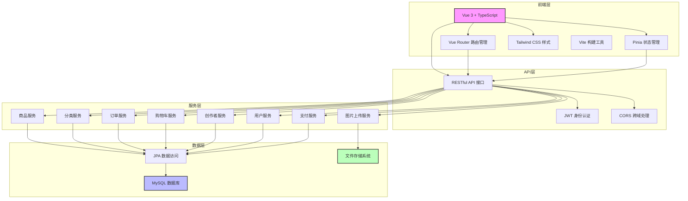

# 开封文创商城系统总体架构图

## 架构说明

### 1. 前端层
- **Vue 3 + TypeScript**：构建现代前端应用，提供类型安全
- **Vue Router**：处理前端路由，实现页面导航
- **Pinia**：状态管理库，管理应用状态
- **Tailwind CSS**：实用优先的CSS框架，快速构建响应式界面
- **Vite**：现代前端构建工具，提供快速的开发体验

### 2. API层
- **RESTful API**：提供标准化的接口规范
- **JWT 身份认证**：实现无状态的用户认证
- **CORS 跨域处理**：支持前端跨域请求

### 3. 服务层
- **商品服务**：管理商品的CRUD操作
- **分类服务**：管理商品分类
- **订单服务**：处理订单的创建、支付和管理
- **购物车服务**：管理用户购物车
- **创作者服务**：管理创作者的申请和审核
- **用户服务**：管理用户的注册、登录和权限
- **支付服务**：处理支付相关逻辑
- **图片上传服务**：处理商品图片的上传和存储

### 4. 数据层
- **MySQL 数据库**：存储系统数据
- **JPA**：Java持久化API，简化数据库操作
- **文件存储系统**：存储上传的图片文件

## 核心流程

1. **用户访问**：用户通过浏览器访问前端应用
2. **路由处理**：Vue Router处理页面导航
3. **API请求**：前端通过API层向后端发送请求
4. **身份认证**：JWT验证用户身份
5. **服务处理**：后端服务处理业务逻辑
6. **数据操作**：通过JPA操作数据库
7. **响应返回**：后端返回处理结果给前端
8. **页面渲染**：前端根据返回数据渲染页面

## 技术特点

- **前后端分离**：前端和后端独立开发和部署
- **模块化设计**：各服务模块职责清晰，易于维护
- **安全性**：JWT认证保护API接口
- **可扩展性**：服务层模块化设计，易于添加新功能
- **响应式设计**：前端使用Tailwind CSS实现响应式界面
